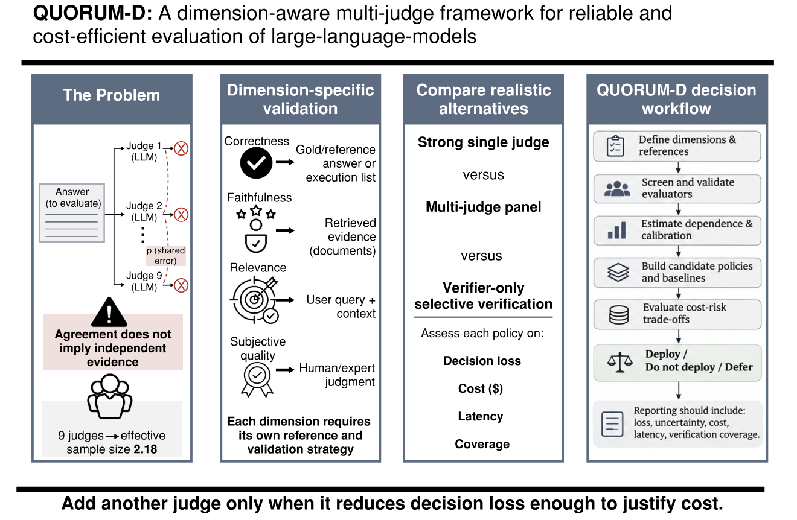
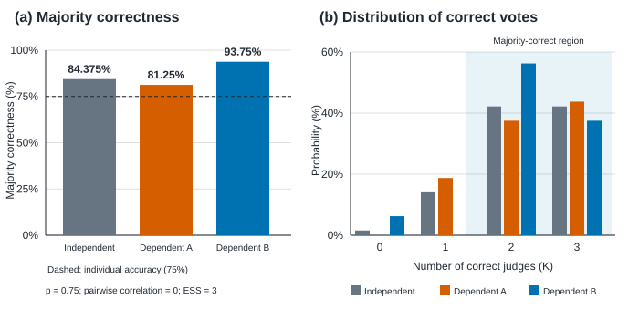
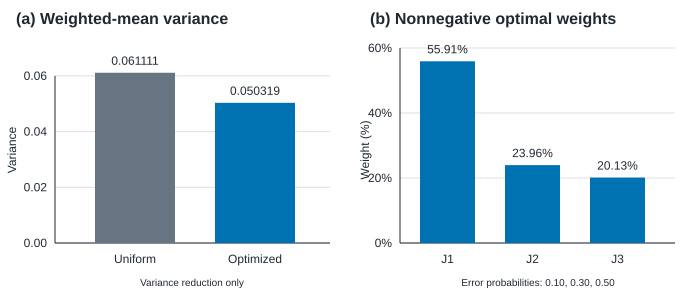
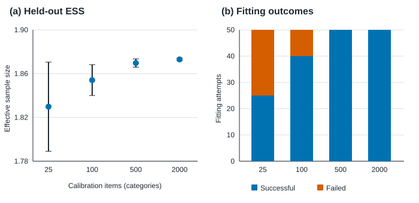
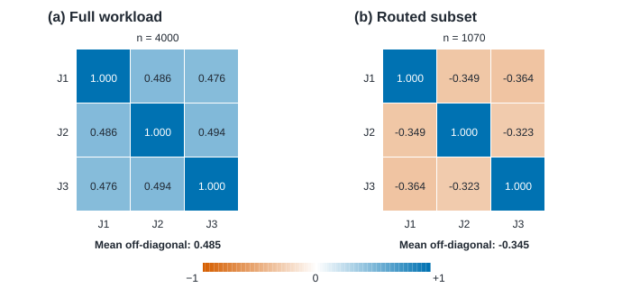
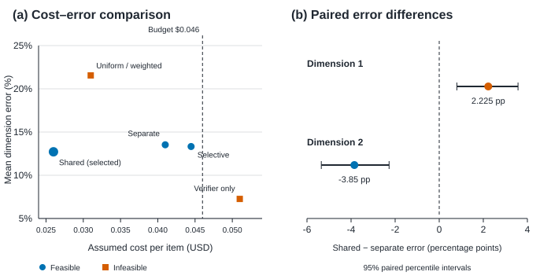

# QUORUM-D

Analytical reproducibility package for **QUORUM-D: A dimension-aware multi-judge framework for reliable and cost-efficient evaluation of large language models**.

**Authors:** Arpan Kumar Ghosh, Soham Ghosh, and Anik Goswami.

## Graphical Abstract



## Scope

Version 0.1.0 implements Equations 1–5, the fixed-panel variance diagnostics, heterogeneous cost example, binary correlation construction, and pivotal-margin property. Figure generators reproduce the numerical curves (not identical visual layout) of Figures 4–6 and Table 6. No API calls, credentials, employer materials or real judge ballots are required. The simulations use synthetic data. A finite-menu synthetic reference implementation demonstrates calibration, joint-policy selection, shared-call accounting, and held-out deployment decisions. Live LLM execution, dynamic candidate generation, and production monitoring are outside this reference implementation.

## Final research outcomes

Start with **[FINAL_RESEARCH_OUTCOMES.md](docs/FINAL_RESEARCH_OUTCOMES.md)** for the targeted mathematical counterexamples, covariance examples, routed-subset diagnostics, paired uncertainty. Earlier numerical findings remain in [validation.md](docs/validation.md). See [reproducibility](docs/reproducibility.md) for the verification report and [manuscript integration](docs/manuscript-integration.md) for manuscript cross-references.

## Research demonstrations and findings

The computational companion isolates statistical mechanisms and illustrates the proposed decision procedure. All judge behavior, prices and latencies in the synthetic experiments are assumed, not measured from real LLMs.

### 1. Majority voting under dependence

The common-shock experiment compares analytical majority probabilities with simulation across 24 conditions: individual correctness probabilities 0.40 and 0.75, pairwise correlations 0, 0.4 and 0.8, and odd panel sizes 1, 3, 5 and 9. Each condition uses 200,000 synthetic items (4.8 million item-condition simulations). Maximum absolute discrepancy: 0.2695 percentage points.

For nine judges with individual correctness probability 0.75:

| Error correlation | Analytical majority accuracy | Simulated accuracy | Effective sample size |
| ---: | ---: | ---: | ---: |
| 0.0 | 95.1073% | 95.0825% | 9.000 |
| 0.4 | 87.0644% | 87.0855% | 2.143 |
| 0.8 | 79.0215% | 78.8780% | 1.216 |

Increasing panel size is beneficial under independent above-chance voting, but not universally. The common-shock construction is one particular joint distribution, not a general accuracy formula for correlated judges.

### 2. Effective sample size (ESS)

Under equal positive marginal error variance and common pairwise error correlation rho, the variance-equivalent size is N / [1 + (N − 1)rho]. For nine judges and correlation 0.391, the result is approximately 2.18. This reproduces the numerical illustration from Kohli (2026) discussed in the review; the repository does not independently reproduce that study's empirical observations. ESS measures variance equivalence, not the probability of a correct majority.

### 3. Exact counterexample: identical ESS, different majority accuracy

Let K be the number of correct votes among three judges; conditional on K, choose the correct judges uniformly. The following distributions all have marginal correctness 0.75, zero pairwise correlation and ESS 3.

| Distribution | P(K=0) | P(K=1) | P(K=2) | P(K=3) | Majority accuracy |
| --- | ---: | ---: | ---: | ---: | ---: |
| Independent | 1/64 | 9/64 | 27/64 | 27/64 | 84.375% |
| Dependent A | 0 | 12/64 | 24/64 | 28/64 | 81.25% |
| Dependent B | 4/64 | 0 | 36/64 | 24/64 | 93.75% |

The two dependent distributions differ by 12.5 percentage points in majority accuracy despite identical first and second moments. This is an exact construction, not an empirical experiment or a claim of mathematical priority.



### 4. Covariance-aware weighting

Independent binary error probabilities 0.10, 0.30 and 0.50 imply variances 0.09, 0.21 and 0.25. Minimum-variance weights [0.55910543, 0.23961661, 0.20127796] reduce weighted-mean error variance from 0.06111111 to 0.05031949 (approximately 17.66%). With reference variance 0.09, the reference-normalized ESS is 1.788571.

The small-panel solver also supports nonnegative active-face optimization for positive definite covariance matrices of up to 12 judges. Lower variance does not establish lower classification error, bias, or expenditure.



### 5. Cost per variance-equivalent unit

Four lightweight calls cost an assumed $0.005 each, with mutual error correlation 0.70. One additional frontier call costs $0.05. The mixed panel costs $0.07 regardless of weighting.

| Panel / cross-tier correlation | Cost/item | Uniform ESS | Minimum-variance ESS | Minimum-variance cost/ESS |
| --- | ---: | ---: | ---: | ---: |
| Four lightweight judges | $0.020 | 1.290 | 1.290 | $0.0155 |
| Mixed / 0.0 | $0.070 | 1.866 | 2.290 | $0.0306 |
| Mixed / 0.2 | $0.070 | 1.667 | 1.871 | $0.0374 |
| Mixed / 0.4 | $0.070 | 1.506 | 1.585 | $0.0442 |
| Mixed / 0.6 | $0.070 | 1.374 | 1.386 | $0.0505 |

Additional information may cost disproportionately more. Cost/ESS is not cost per correct verdict; reweighting a fixed set of paid calls does not itself save money.

### 6. Finite calibration sensitivity

A fixed synthetic five-judge model is fitted 50 times at each calibration size using correlation shrinkage 0.9 R-hat + 0.1 I. An independent 100,000-item test tape evaluates fitted weights.

| Calibration items | Successful fits | Mean test ESS | SD |
| ---: | ---: | ---: | ---: |
| 25 | 25/50 | 1.829815 | 0.040717 |
| 100 | 40/50 | 1.854071 | 0.014047 |
| 500 | 50/50 | 1.869678 | 0.003743 |
| 2,000 | 50/50 | 1.872989 | 0.001169 |

Means and standard deviations are conditional on successful fits. Failures include constant error indicators and inadmissible closed-form weights. This illustrates estimation instability, not a universal sample-size requirement.



### 7. Selective routing and conditional dependence

On the 4,000-item synthetic held-out tape, three lightweight judges have mean pairwise error correlation +0.485237 on the full first-dimension workload. Restricting measurement to the 1,070 items (26.75%) with observable 2–1 split votes changes the correlation to −0.345244.

Routing uses ballots, not reference labels; labels are used afterward to measure errors. Conditional correlation describes the jointly observed subset and does not establish independence or improved accuracy.



### 8. End-to-end finite-menu QUORUM-D demonstration

The reference implementation uses two generic binary dimensions and independent synthetic tapes with distinct item IDs.

| Dataset | Items | Seed | Purpose |
| --- | ---: | ---: | --- |
| Calibration | 1,000 | 51 | Estimate competence and fit weights |
| Development | 4,000 | 52 | Compare candidate policies |
| Held-out test | 4,000 | 53 | Evaluate the frozen policy and declared baselines |

Assumed error probabilities:

| Evaluator | Dimension 1 | Dimension 2 |
| --- | ---: | ---: |
| Lightweight judges (three per dimension) | 22% | 25% |
| Strong single judge | 10% | 18% |
| Shared single judge | 12% | 14% |
| External verifier | 6% | 9% |

Six rules per dimension (single, uniform panel, weighted panel, verifier-only, selective verification, and deferral) give 36 separate-call combinations. One shared-call configuration gives 37 candidates. The shared call is charged once and has its own simulated outcomes.

The declared constraints are $0.046/item, p95 modeled latency at most 2 seconds, coverage at least 95% per dimension, and accepted-case Wilson upper error endpoints at most 17% and 19%. The objective adds cost and all-item loss priced at $0.15 per dimension per loss unit, with deferral loss 0.5 and amortized calibration cost $0.001/item. Wilson endpoints are empirical selection diagnostics, not simultaneous risk guarantees.

Four development configurations are feasible:

| Configuration | Development objective |
| --- | ---: |
| single+verifier | 0.073675 |
| single+selective | 0.0798875 |
| selective+selective | 0.08495625 |
| shared+shared (selected) | 0.065000 |

Selection minimizes the computed development objective among feasible policies, with exact ties broken by complexity and then policy name. The selected policy and declared baselines are evaluated using the same held-out items and reference labels, without reselection. The Wilson endpoints use nominal two-sided 95% score intervals (z = 1.96). All 37 candidates were evaluated, including the required baselines; the restricted implementation does not enforce the revised general algorithm's mandatory-baseline budget reservation for arbitrary truncated searches.

The shared policy is frozen before held-out evaluation. Results for the selected policy and declared baselines:

| Policy | Assumed cost/item | D1 error | D2 error | Feasible |
| --- | ---: | ---: | ---: | --- |
| Separate single judges | $0.04100 | 9.675% | 17.375% | Yes |
| Uniform panels | $0.03100 | 19.750% | 23.350% | No |
| Competence-weighted panels | $0.03100 | 19.750% | 23.350% | No |
| Verifier-only | $0.05100 | 5.775% | 8.750% | No |
| Selective verification | $0.04447 | 11.600% | 15.050% | Yes |
| Shared single judge | $0.02600 | 11.900% | 13.525% | Yes |

The shared policy costs 36.59% less than separate single judges under the assumed prices. The verifier is most accurate but exceeds the budget; uniform and weighted panels exceed both risk limits. Three held-out policies satisfy the constraints, distinct from the four development-feasible candidates. Not all development candidates are retested. The selected policy is a simulated deployment candidate, not a real deployment approval.

Detailed held-out feasibility diagnostics (Supplement S1, §S1.8):

| Policy | Modeled p95 (s) | Accepted D1 | Accepted D2 | Wilson upper D1 | Wilson upper D2 |
| --- | ---: | ---: | ---: | ---: | ---: |
| Separate single judges | 1.0 | 4000/4000 | 4000/4000 | 10.630% | 18.580% |
| Uniform panels | 1.2 | 4000/4000 | 4000/4000 | 21.013% | 24.686% |
| Competence-weighted panels | 1.2 | 4000/4000 | 4000/4000 | 21.013% | 24.686% |
| Verifier-only | 1.5 | 4000/4000 | 4000/4000 | 6.541% | 9.666% |
| Selective verification | 2.0 | 4000/4000 | 4000/4000 | 12.629% | 16.192% |
| Shared single judge | 1.1 | 4000/4000 | 4000/4000 | 12.940% | 14.620% |

See [complete policy results](docs/POLICY_SELECTION_RESULTS.md) for the underlying archive.

### 9. Paired uncertainty

A paired IID bootstrap of the same 4,000 test items uses 2,000 resamples per dimension (seeds 2026 and 2027).

| Dimension | Shared minus separate error | 95% percentile interval |
| --- | ---: | ---: |
| 1 | +2.225 percentage points | [+0.800, +3.575] pp |
| 2 | −3.850 percentage points | [−5.350, −2.275] pp |

The shared policy trades worse first-dimension accuracy for better second-dimension accuracy in this synthetic comparison. These pointwise descriptive intervals do not establish real-world model performance or simultaneous risk control.



## Repository structure and manuscript mapping

| Location | Responsibility |
| --- | --- |
| [quorum_d/statistics.py](quorum_d/statistics.py) | Majority probability, ESS, error dependence and weighting (Sections 2, 4–5) |
| [quorum_d/research_checks.py](quorum_d/research_checks.py) | Exact counterexamples, full covariance, conditional dependence and paired bootstrap (Sections 4.2–4.3.1, 6.5) |
| [quorum_d/policy.py](quorum_d/policy.py) | Cost–risk objective, constraints and selection (Section 6.1) |
| [quorum_d/reference.py](quorum_d/reference.py) | Frozen synthetic finite-menu pipeline (Section 6.5) |
| [scripts/](scripts/) | Experiment execution, archive verification and figure generation |
| [results/](results/) | Archived analytical and synthetic outputs |
| [tests/](tests/) | Statistical and policy implementation checks |
| [docs/](docs/) | Research results, assumptions, limitations and manuscript traceability |

Table 5 and Figure 3 describe the exact counterexample; Table 6 and Figures 4–6 cover numerical ESS and cost illustrations; Table 9 and Figure 8 describe synthetic held-out policies. Supplementary Figure S1 illustrates conditional dependence.

The contribution is the integration of criterion validity, dependence diagnostics, decision loss, resource accounting and held-out validation. Majority voting, ESS, covariance optimization and bootstrap are established techniques. This package does not claim empirical superiority or implement all of Algorithm 1.

## Reproduce

From the repository root, using Python 3.11 or newer for the pinned research environment:

```sh
python -m venv .venv
source .venv/bin/activate
python -m pip install -r requirements-reproduce.txt
python -m pip install -e '.[test]'
python -m pytest -q
python -m scripts.verify_archive
python -m scripts.reproduce --output results
python -m scripts.claim_experiments
python -m scripts.policy_demo
python -m scripts.reference_demo
python -m scripts.strengthen
```

Generated files: figure3.svg, figure4.svg, figure5.svg, table5.csv, synthetic_correlation.csv, majority_simulation.csv, calibration_sensitivity.csv, policy_demo.json, reference_demo.json, strengthening.json, and docs/FINAL_RESEARCH_OUTCOMES.md. The simulation uses 200,000 synthetic items, error probability 0.25 and seed 34. Dependencies and platforms can affect floating-point rounding and graphical layout. On Windows, activate the venv using its Scripts directory.

## Example

```python
from quorum_d import effective_size, majority_accuracy
print(effective_size(9, 0.391))
print(majority_accuracy(9, 0.4))
```

ESS describes variance equivalence under stated assumptions; it does not determine majority accuracy. Equal positive marginal variance is required for the correlation-based weighted ESS. The minimum-variance helper implements the closed form only when the correlation matrix is positive definite and the unconstrained optimum is nonnegative. It is not an accuracy optimizer. The targeted research checks also include a nonnegative active-face minimum-variance solver for small positive definite panels and explicitly reference-normalized unequal-variance diagnostics.

## Archived research results

The numerical output snapshots in [results](results/) are committed alongside the source. Re-run the commands above to regenerate figures and the full per-policy JSON reports; vector figures and complete generated outputs are also available as GitHub Actions artifacts. The CSVs are analytical or synthetic, not real model observations. See [validation](docs/validation.md) and [claim traceability](docs/claims.md). This repository is a companion to the review paper, not an SDK or production platform.

## Research status

See [claim traceability](docs/claims.md). The reported published results are not independently replicated by this package. Analytical tests and synthetic simulations are not empirical validation of QUORUM-D. Eq. 5 evaluates supplied cost and loss values; the reference search enumerates a finite, prespecified menu rather than solving the unrestricted joint-policy problem. No claim of global optimality or formal risk control is made.

## Publication figures

See [Figure guide](docs/FIGURE_GUIDE.md) for manuscript-ready vector figures and captions. Regenerate SVGs with `node scripts/publication_figures.cjs` (Node 18+). Optional PDF and 600 dpi PNG exports: `python -m pip install cairosvg` (requires system Cairo), then `python -m scripts.export_publication_figures`.

## Final verification and full policy selection

See [provenance and verification](docs/FINAL_VERIFICATION.md) and [all development and held-out policies](docs/POLICY_SELECTION_RESULTS.md). After `python -m scripts.reference_demo`, run `python -m scripts.archive_policy_report` to regenerate the Markdown table; `python -m scripts.verify_archive` compares it along with the seven original artifacts.

## Research transparency

See [verification and research disclosures](docs/FINAL_VERIFICATION.md).
